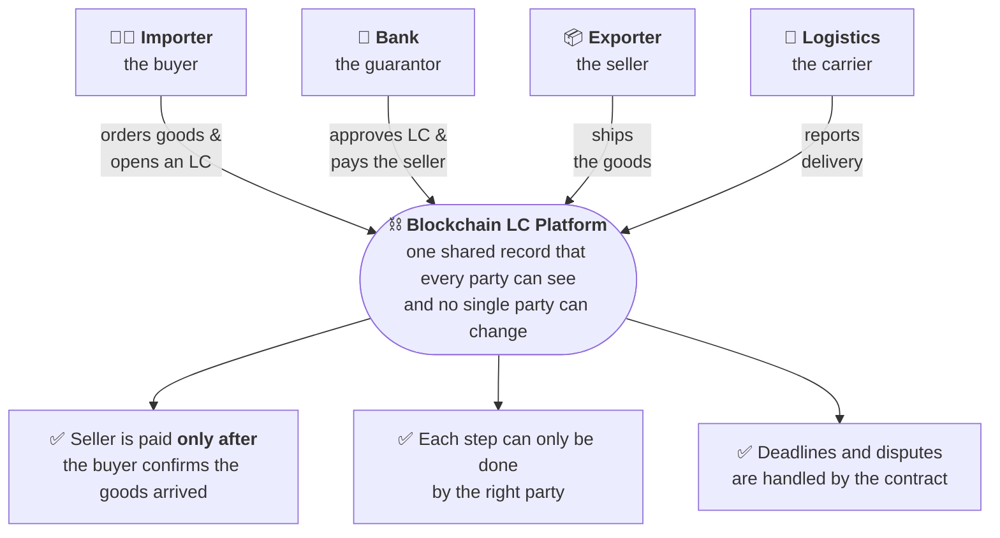
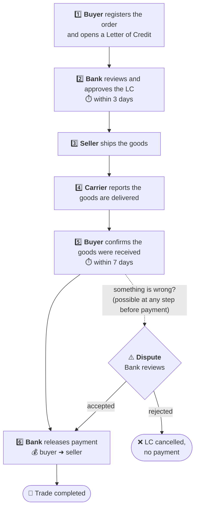

# Blockchain-based Supply Chain Finance – Digital Letter of Credit Platform

A proof-of-concept that moves the **Letter of Credit (LC)** process in trade finance onto Ethereum smart contracts. Importer, Exporter, Bank, and Logistics provider work on one shared on-chain record, and the Bank can release payment **only after the goods are confirmed as received** in the supply-chain contract.

> ⚠️ Academic / demo project. Runs on a local Hardhat network (chainId `31337`) with a mock stablecoin (`mUSD`). Not for production use.

---

## 1. Problem & Solution

| Traditional LC | This platform |
|---|---|
| Paper documents passed between banks, buyer, seller, carrier | One on-chain LC record; every status change emits an event |
| Each party sees only part of the process | All parties read the same LC and product state |
| Manual checks of who may do what | `RoleRegistry` enforces who can call each function |
| Payment depends on manual document review | `releasePayment` is only possible after delivery is confirmed **and** the product is marked *Received* on-chain |
| Delays have no built-in consequence | SLA deadlines checked in the contract (Bank approval ≤ 3 days, delivery confirmation ≤ 7 days) |
| Disputes handled off-system | Any LC party can raise a dispute on-chain; the Bank resolves it |

---

## 2. The Big Picture



**In one sentence:** the buyer's bank promises to pay the seller, and the smart contract makes sure that money only moves once the goods have really been delivered and received.

---

## 3. Roles

Roles are stored in `RoleRegistry` (`enum Role { NONE, ADMIN, BANK, EXPORTER, IMPORTER, LOGISTICS }`). Only the Admin (the deployer) can grant or revoke them.

| Role | SupplyChain | LetterOfCredit | Frontend page |
|---|---|---|---|
| **Admin** | – | – | (deploy script) |
| **Importer** (buyer) | `createProduct`, `confirmReceived` | `openLC`, `confirmDelivered`, `raiseDispute` | `/importer/open-lc`, `/importer/dashboard` |
| **Bank** | – | `approveLC`, `confirmDelivered`, `releasePayment`, `raiseDispute`, `resolveDispute` | `/bank/dashboard` |
| **Exporter** (seller) | – | `confirmShipment`, `raiseDispute` | `/exporter/dashboard` |
| **Logistics** | `markDelivered` | `markDeliveredPending` | `/logistics/dashboard` |

---

## 4. How a Trade Works, Step by Step



Every step above is a transaction on the blockchain: it is recorded with a timestamp, and the contract refuses it if the wrong party tries it or the previous step has not happened yet. Step 6 is impossible until step 5 is done.

Behind the scenes, each step maps to one smart-contract function:

| Step | Who | Function |
|---|---|---|
| 1 | Importer | `SupplyChain.createProduct`, `USDToken.approve`, `LetterOfCredit.openLC` |
| 2 | Bank | `approveLC` |
| 3 | Exporter | `confirmShipment` |
| 4 | Logistics | `SupplyChain.markDelivered`, `markDeliveredPending` |
| 5 | Importer | `SupplyChain.confirmReceived`, `confirmDelivered` |
| 6 | Bank | `releasePayment` (pulls mUSD from Importer to Exporter) |
| Dispute | Buyer / Seller / Bank → Bank | `raiseDispute` → `resolveDispute` |

The platform is made of four contracts: **RoleRegistry** (who can do what), **SupplyChain** (shipment status), **LetterOfCredit** (LC steps, deadlines, disputes, payment) and **USDToken** (a mock stablecoin used for payment).

---

## 5. Business Rules Enforced On-chain

| Rule | Where |
|---|---|
| Only an Importer can open an LC, and the seller must have the Exporter role | `openLC` |
| Bank must approve within **3 days** of the LC being opened, otherwise `Approval SLA missed` | `approveLC` |
| The approving Bank becomes the LC's bank; only that bank can release payment or resolve disputes | `approveLC`, `releasePayment`, `resolveDispute` |
| Only the LC's seller can confirm shipment | `confirmShipment` |
| Delivery must be confirmed within **7 days** of Logistics marking it, otherwise `Delivery SLA missed` | `confirmDelivered` |
| Delivery can only be confirmed if the product is `Received` in SupplyChain | `confirmDelivered` |
| Disputes can be raised by buyer, seller or bank at any stage before `PAID` | `raiseDispute` |
| Only the importer who created a product can confirm it was received | `SupplyChain.confirmReceived` |

---

## 6. Tech Stack

| Layer | Technology |
|---|---|
| Smart contracts | Solidity 0.8.20 (optimizer 200 runs), OpenZeppelin Contracts 4.9 |
| Development & testing | Hardhat 2, TypeChain, Chai, TypeScript |
| Frontend | Next.js 16 (App Router), React 19, Tailwind CSS 4, ethers.js v6, lucide-react |
| Wallet | MetaMask (`BrowserProvider` + `eth_requestAccounts`) |

---

## 7. Project Structure

```
.
├── contracts/
│   ├── core/RoleRegistry.sol          # Role management
│   ├── business/SupplyChain.sol       # Product tracking
│   ├── business/LetterOfCredit.sol    # LC lifecycle, SLA, dispute, payment
│   ├── tokens/USDToken.sol            # Mock ERC-20 (mUSD)
│   └── interfaces/                    # IRoleRegistry, ISupplyChain, ILetterOfCredit
├── scripts/
│   ├── deploy.ts                      # Deploy all contracts + demo setup
│   └── create-product.ts              # Create sample products
├── test/                              # Hardhat tests
├── deployments/deployment-31337.json  # Addresses from the last local deploy
└── frontend/
    └── src/
        ├── app/                       # Role-based pages (importer, bank, exporter, logistics)
        ├── contracts/abi/             # Contract ABIs
        └── lib/                       # ethers signer + contract helpers
```

---

## 8. Getting Started

**Requirements:** Node.js 18+, npm, MetaMask

```bash
# 1. Install dependencies
npm install

# 2. Create .env in the project root
#    MNEMONIC=" test test test ... junk"   (a test-only mnemonic)

# 3. Compile
npm run compile

# 4. Start a local blockchain (terminal 1)
npm run node

# 5. Deploy contracts + demo data (terminal 2)
npm run deploy
```

`scripts/deploy.ts` will:
1. Deploy `USDToken → RoleRegistry → SupplyChain → LetterOfCredit` (in this order).
2. Use Hardhat accounts #0–#4 as **Admin, Bank, Importer, Exporter, Logistics** and grant their roles.
3. Send 500,000 mUSD to the Importer and approve the LC contract to spend it.
4. Create a demo product (`productId = 0`) and a demo LC (`lcId = 1`, 100,000 mUSD).
5. Save all addresses to `deployments/deployment-31337.json`.

Then run the frontend:

```bash
cd frontend
npm install
# Create frontend/.env.local with the addresses from deployments/deployment-31337.json:
# NEXT_PUBLIC_USD_TOKEN_ADDRESS=...
# NEXT_PUBLIC_ROLE_REGISTRY_ADDRESS=...
# NEXT_PUBLIC_SUPPLY_CHAIN_ADDRESS=...
# NEXT_PUBLIC_LETTER_OF_CREDIT_ADDRESS=...
npm run dev
```

Open `http://localhost:3000`, add the Hardhat network (RPC `http://127.0.0.1:8545`, chainId `31337`) to MetaMask, import the accounts for each role, and switch accounts to act as Importer, Bank, Exporter, or Logistics.

---

## 9. Known Limitations & Future Work

- **No escrow:** funds stay in the Importer's wallet until `releasePayment` pulls them with `transferFrom`. A future version should lock funds in the contract when the Bank approves the LC.
- **No document verification yet:** invoices, bills of lading, etc. are not stored on-chain. Next step: store document hashes (e.g. via IPFS) and verify them before payment.
- **Two separate status updates:** Logistics and Importer each have to update both `SupplyChain` and `LetterOfCredit`. These could be merged into one call.
- **SLA is checked, not enforced automatically:** A missed deadline only blocks the action; nothing moves the LC to `UNDER_REVIEW` on its own.
- **Tests are out of date:** `test/*.ts` still call an old API (`updateStatus`, `released`) and need to be rewritten for the current contracts.
- `ILetterOfCredit.sol` describes an older design and is not implemented by `LetterOfCredit.sol`.
- Single admin; no multi-sig, no upgradeability; tested only on a local Hardhat network.
